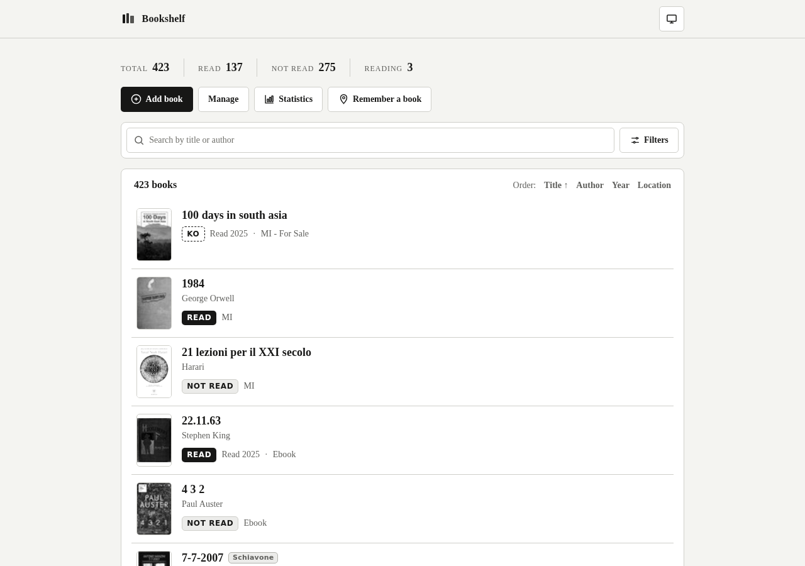
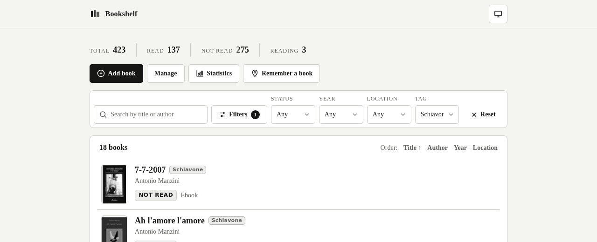
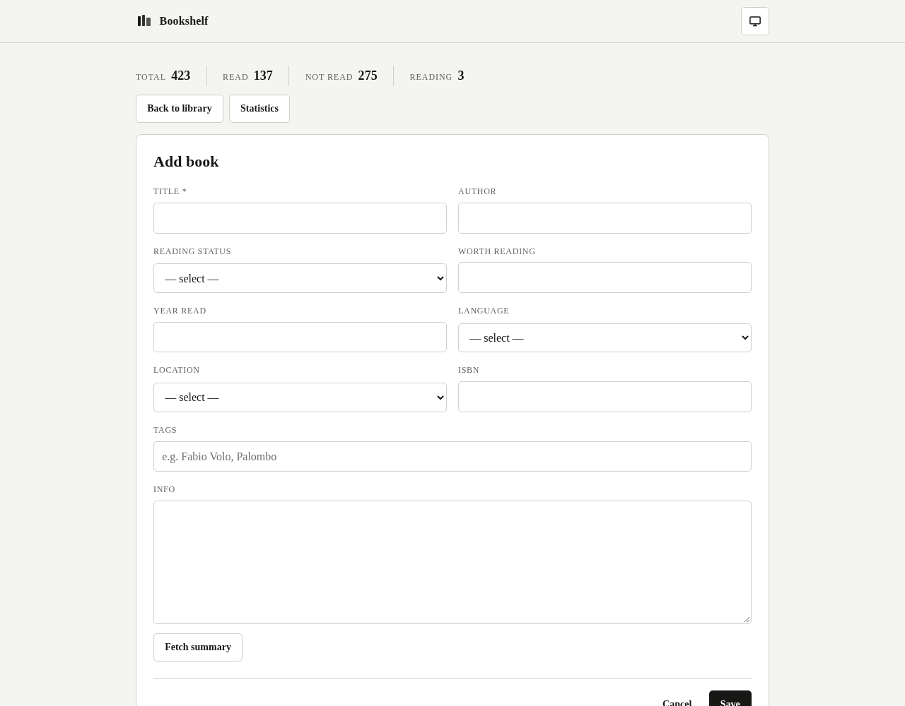
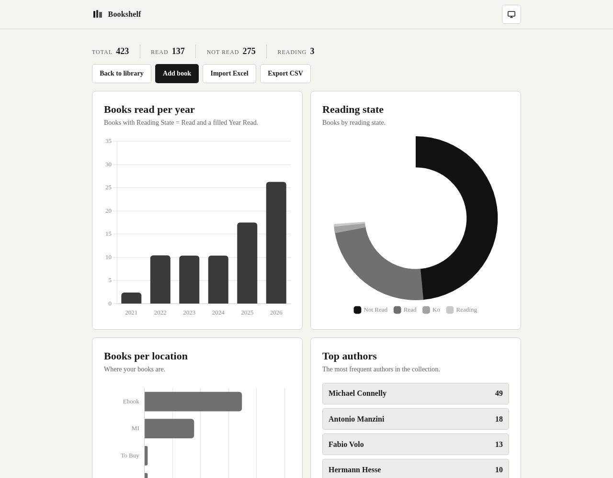
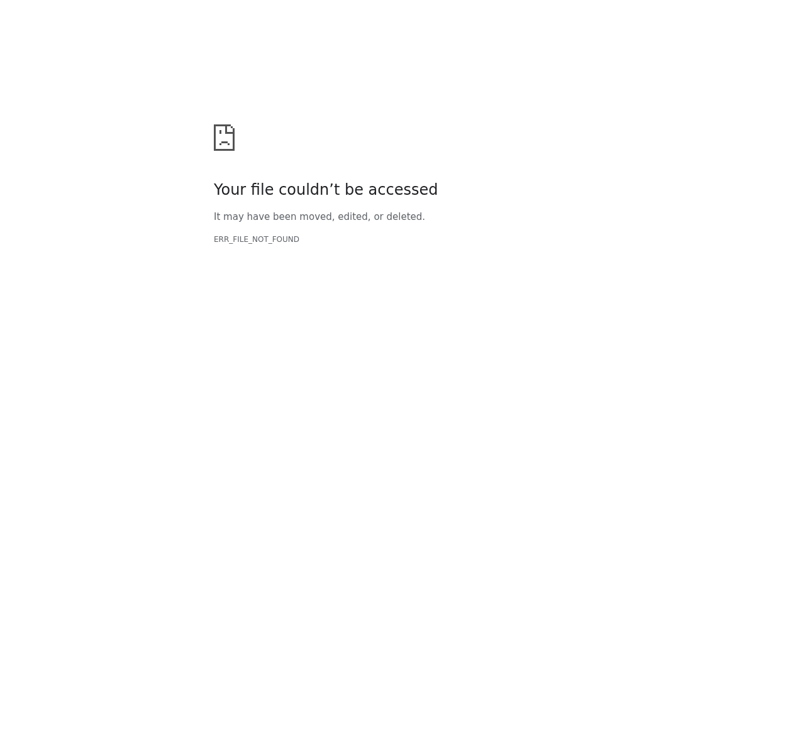
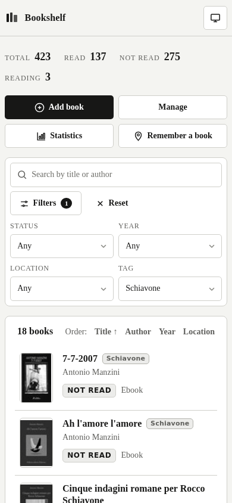

# Bookshelf

A self-hosted, browser-based personal book library manager. Runs on port 8080, built with FastAPI, Jinja2, SQLite, and Docker.



## Features

- **Book list** with live search (title & author) and sorting
- **Filters**: Reading State, Year Read, Location, Tag — compact filter bar with a collapsible panel
- **Add / edit / delete** books with a clean two-column form
- **Tags**: multiple, reusable tags per book (e.g. "who recommended it"), shown as small badges next to the title; filter by tag
- **Import** from Excel (`.xlsx`) with duplicate detection (title + author)
- **Export** the current filtered view as CSV or Excel
- **Statistics** page: books read per year, reading state, books per location, top authors
- **Auto cover & summary** (optional, via Google Books / Open Library + Groq): fetched automatically when you add a book, in the book's language
- **Autofill** page to batch-fill missing summaries, **Coverfill** page to batch-fetch missing covers
- **AI recall**: describe a vague memory of a book and find it in your library
- **E-ink inspired UI**: grayscale, squared controls, serif typography, light / dark / follow-OS theme switcher
- Responsive (desktop, tablet, mobile)

## Screenshots

| Library | Filters open |
|---|---|
|  |  |

| Book form | Statistics |
|---|---|
|  |  |

| Dark mode | Mobile |
|---|---|
|  |  |

## Stack

- **FastAPI** — backend and routing
- **Jinja2** — server-side HTML templates
- **SQLite** — local database (no external DB required)
- **Docker / Docker Compose** — containerised deployment
- **Open Library / Google Books / Groq** — covers, descriptions, AI translation (optional)

## Book Fields

All fields are optional except `Title`. A book can have **multiple tags**.

| Field | Notes |
|---|---|
| Title | Required |
| Author | |
| Reading Status | `Read`, `Not Read`, `Reading`, `KO` — drives the Reading State pill |
| Worth Reading | |
| Year Read | |
| Location | Where the book is physically or digitally stored (e.g. `Ebook`, `MI`) |
| Tags | Comma-separated, reusable; e.g. `Fabio Volo, Palombo` |
| Language | `IT` / `EN` — drives summary fetching |
| ISBN | |
| Release Date | |
| Current Page / Total Pages | |
| Rating | |
| Description | Summary (fetched or entered) |
| Notes | |

## Reading State Logic

The app stores two separate fields:

- `status_raw` — the original text value (e.g. `"Read"`, `"Not Read"`, `"Reading"`)
- `reading_bucket` — the normalised value used for filtering and the coloured pill (`read`, `not_read`, `reading`, `ko`, `other`)

`reading_bucket` is computed automatically from `status_raw` on every save.

## Getting Started

```bash
docker compose up --build
```

Then open:
- `http://localhost:8080`
- or `http://<your-machine-ip>:8080` from the LAN

## Import from Excel

Put `Bookshelf.xlsx` in the `imports/` folder, then use **Import Excel** from the interface.

Deduplication on import: a book is skipped if an entry with the same `title` + `author` already exists.

## Export

From the library page, **Export CSV** / **Export Excel** export the currently filtered list.

## Environment Variables

Set these in a `.env` file for AI/cover features:

```
GROQ_API_KEY=...
GOOGLE_BOOKS_API_KEY=...
```

Both are optional; the app works without them (no auto-fetch, no AI recall).

## Notes

- Tagged books can carry multiple tags; the tag list is derived from existing tags and grows as you create new ones.
- New books automatically fetch their cover and summary in the background.
- The theme button cycles through **Light / Dark / Follow OS**.
- Covers and UI are intentionally grayscale (e-ink aesthetic).
